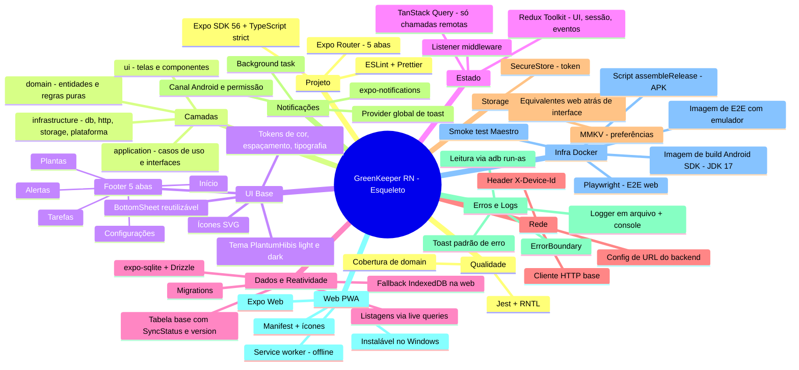
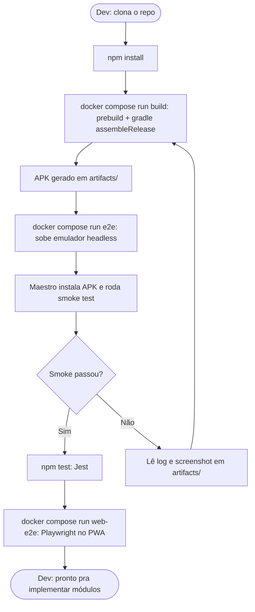
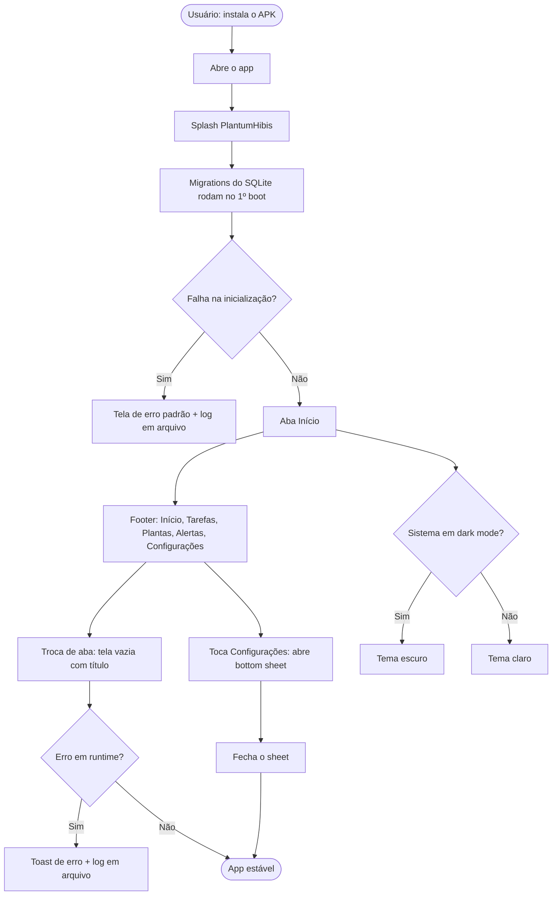
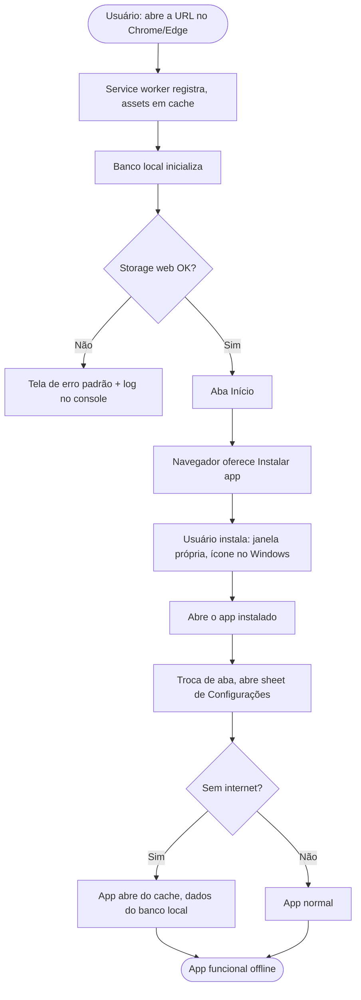
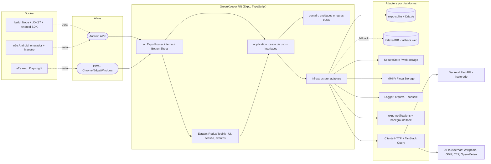

## Visão

**Problema:** O frontend MAUI exige o toolchain .NET/MAUI (workload pesado, build Android lento e frágil em path longo no Windows) e tem E2E cujo input não roda no sandbox. Falta uma base Android reproduzível por Docker, com testes automatizados que rodem de verdade e uma stack web-first que permita também um PWA.
**Solução:** App GreenKeeper/PlantumHibis em React Native + TypeScript (Expo SDK 56), com alvo nativo **100% Android** e um segundo alvo **PWA** instalável (Chrome/Edge/Windows) sobre a mesma base de código. Paridade com o comportamento Android do MAUI, migrada por módulos em changes sequenciais. Esta change entrega só o **esqueleto**: projeto, camadas, tema, 5 abas vazias, banco local, estado, HTTP, logs, erros, notificações (base), Docker de build/E2E e PWA. Build do APK e E2E (emulador Android + Playwright web) rodam via Docker.
**Usuários-alvo:** Wesley (dev) nesta change; usuários de plantas em Android e no PWA a partir das changes de módulos.

## Mapa Funcional

## Jornadas de Usuário

### Dev

### Usuário Android

### Usuário PWA

## Arquitetura Macro

## Funcionalidades por Área

| Funcionalidade | Ator | Prioridade | Complexidade |
|---|---|---|---|
| Projeto Expo + TS strict + lint/format | Dev | Alta | P |
| Camadas domain/application/infrastructure/ui + composition root | Dev | Alta | M |
| Expo Router com 5 abas e placeholders | Usuário | Alta | P |
| Tema PlantumHibis light/dark (tokens) | Usuário | Alta | M |
| Ícones SVG (react-native-svg) | Usuário | Média | P |
| BottomSheet reutilizável + sheet de Configurações | Usuário | Alta | M |
| Redux Toolkit (UI/sessão/eventos) + regra "sem entidades no Store" | Dev | Alta | M |
| expo-sqlite + Drizzle + migrations + tabela base | Dev | Alta | G |
| Listagens por live query (regra de reatividade) | Dev | Alta | M |
| Fallback IndexedDB atrás da interface de banco (web) | Dev | Alta | G |
| Cliente HTTP base + config de URL + X-Device-Id | Dev | Alta | M |
| SecureStore / MMKV e equivalentes web atrás de interface | Dev | Média | M |
| Logger em arquivo (Android) + console | Dev | Alta | M |
| ErrorBoundary + toast padrão de erro | Usuário | Alta | M |
| Base de notificações (canal, provider global, background task) | Dev | Média | M |
| PWA: manifest, ícones, service worker, instalável, offline | Usuário | Alta | G |
| Docker build do APK (JDK 17 + Android SDK) | Dev | Alta | G |
| Docker E2E Android (emulador + Maestro) com smoke test | Dev | Alta | G |
| Docker E2E web (Playwright) com smoke test | Dev | Média | M |
| Jest + RNTL + testes de domain/Store | Dev | Alta | M |
| .gitignore, .graphifyignore, README, CLAUDE/AGENTS/GEMINI, graphify | Dev | Alta | P |

## Viabilidade

- [x] A solução resolve o problema declarado
- [x] Não duplica funcionalidade já existente no sistema (repo novo; MAUI segue como referência)
- [x] Stack tecnológica disponível ou definida (Expo SDK 56, RN 0.85, expo-sqlite + Drizzle, Redux Toolkit, Maestro, Playwright, JDK 17)
- [x] Escopo é delimitável (esqueleto sem módulos de negócio; módulos em changes sequenciais)
- [ ] Emulador Android em Docker roda neste ambiente (exige KVM; Windows nativo não expõe — provável WSL2 com virtualização aninhada; validar no spike)
- [ ] `expo-sqlite` funciona na web (WASM/OPFS) ou fallback IndexedDB cobre (validar no spike)
- [ ] JDK 17 confirmado como o exigido pelo template do Expo SDK 56 (validar no build do spike)
- [ ] Estimativa de esforço aceitável (esqueleto grande por incluir Docker + PWA; reavaliar após spikes)

## Riscos Iniciais

| Risco | Probabilidade | Impacto | Mitigação |
|---|---|---|---|
| Emulador Android no Docker sem KVM no Windows | Alta | Alto | Spike na task 1; rodar Docker dentro do WSL2 com nested virtualization; plano B: runner Linux/CI |
| `expo-sqlite` na web instável (COOP/COEP, OPFS) | Média | Alto | Spike; interface de banco com adapter IndexedDB de fallback sem mudar telas |
| Paridade Android vs web diverge (SecureStore, câmera, GPS, notificação) | Alta | Médio | Interfaces em `infrastructure`; adapters separados; recursos não suportados desligados explicitamente na web |
| Live queries com join não observam todas as tabelas | Média | Médio | Teste de reatividade por tela; regra de spec; observar tabelas explicitamente |
| Time põe listas/entidades de domínio no Redux | Média | Médio | Regra na spec + teste de reflexão sobre os slices |
| Versão do JDK/Gradle incompatível com o template do SDK 56 | Baixa | Médio | JDK só na imagem Docker; troca é de uma linha |
| Esqueleto grande demais (Docker + PWA + base) | Média | Médio | Tasks granuladas com commit por grupo; spikes primeiro com ponto de replanejamento |

## Fora de Escopo

- Telas e regras de negócio: auth, casas, áreas, plantas, tarefas, alertas, perfil, sync, dashboard (changes 2 a 10).
- Sync com o Backend (só o cliente HTTP base entra).
- Lógica de geração de alertas e permissão de notificação (só a base de infraestrutura).
- Hospedagem/deploy do PWA (roda local e no Docker).
- iOS e builds nativos Windows.
- Alterações no Backend FastAPI e no repo MAUI.
- Toggle manual de tema (segue o sistema).
- Publicação na Play Store e assinatura de release.
