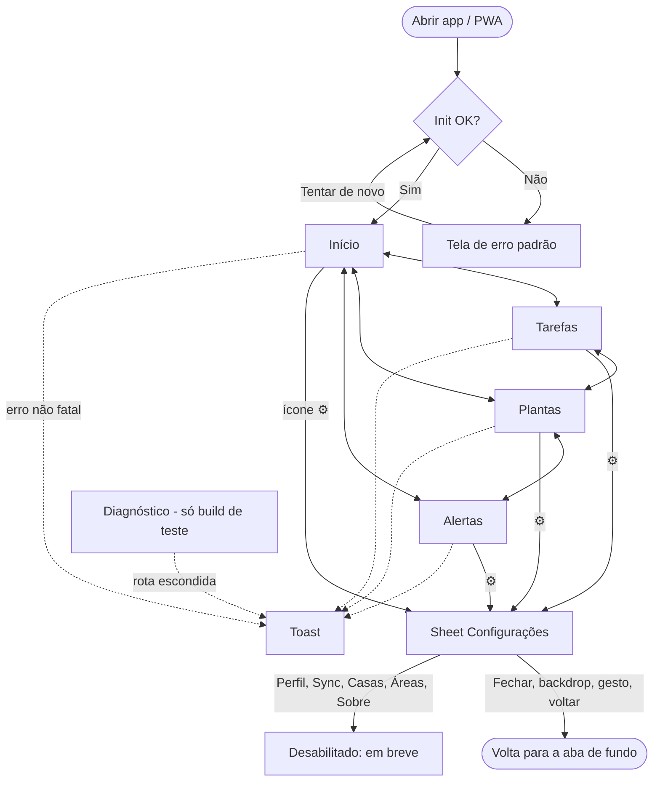

## Fluxo de Navegação



Notas de design (derivadas do mockup `design/mockups/screens/inicio.html` do repo MAUI):
- O footer tem 5 ícones Lucide (`home`, `list-checks`, `leaf`, `bell`, `settings`), sem rótulo visível. O ícone ⚙ é gatilho de sheet, não rota. Há **4 telas** de aba mais o sheet.
- Aba ativa em `--accent`; Plantas sempre em `--pink`; inativas em `--muted`. Barra de status em `--purple`.
- Tokens do mockup vêm em `oklch`; no RN são convertidos para hex/rgb nos tokens do tema.
- Cada ícone do footer tem `accessibilityLabel`, já que não há rótulo visível.

## Telas

### Abas placeholder (Início, Tarefas, Plantas, Alertas)

**Rota:** `/` (Início), `/tarefas`, `/plantas`, `/alertas`
**Ator:** Usuário
**Use Cases atendidos:** UC-01, UC-02

#### Wireframe

```
+--------------------------------------------------+
| ▓ barra de status (roxa, --purple)               |
+--------------------------------------------------+
|  Início                    (título da aba)       |
+--------------------------------------------------+
|                                                  |
|                    ( ícone da aba, 48px,         |
|                      cor muted )                 |
|                                                  |
|              Em breve                            |
|        Este módulo chega nas                     |
|        próximas versões                          |
|                                                  |
+--------------------------------------------------+
|  🏠(ativo)   ☑     🍃(rosa)    🔔     ⚙          |
+--------------------------------------------------+
```

#### Estados da Tela
- **Vazio:** estado padrão (placeholder "Em breve").
- **Loading:** splash enquanto o banco inicializa (UC-04); sem skeleton por aba.
- **Erro de validação:** n/a.
- **Erro de servidor:** n/a (nenhuma chamada nas abas); erro de init vai para a tela de erro padrão.
- **Sucesso:** n/a.

#### Componentes
- `ScreenContainer` — fundo do tema e safe area.
- `ScreenHeader` — título da aba.
- `EmptyState` — ícone, título e texto.
- `BottomNav` — 5 ícones Lucide; ativo em `--accent`, Plantas em `--pink`.
- `StatusBarBackground` — barra de status roxa.

#### Ações e Navegação
- **Ícone de aba** → troca a rota e a aba ativa muda de cor; toque na aba ativa não faz nada (UC-01).
- **Ícone ⚙** → abre o Sheet de Configurações sem trocar a rota (UC-03).

---

### Sheet de Configurações

**Rota:** sem rota (overlay)
**Ator:** Usuário
**Use Cases atendidos:** UC-03

#### Wireframe

```
+--------------------------------------------------+
| (tela de fundo, escurecida pelo backdrop)        |
+==================================================+
|                 ───  (handle)                    |
|  Configurações                                   |
|                                                  |
|  👤  Perfil                    [em breve]        |
|  🔄  Sincronização             [em breve]        |
|  🏢  Casas                     [em breve]        |
|  📍  Áreas                     [em breve]        |
|  ℹ️  Sobre o App               [em breve]        |
|                                                  |
|  [            Fechar            ]                |
+--------------------------------------------------+
```

#### Estados da Tela
- **Vazio:** padrão, 5 opções desabilitadas com selo "em breve".
- **Loading:** n/a.
- **Erro de validação:** n/a.
- **Erro de servidor:** n/a.
- **Sucesso:** n/a.

#### Componentes
- `BottomSheet` — reutilizável: handle, backdrop, gesto de arrastar, `onClose`.
- `SettingsOption` — ícone Lucide, rótulo e selo.
- `Button` secundário "Fechar" em largura total.

#### Ações e Navegação
- **Opção** → desabilitada; sem ação no esqueleto (cada uma vira funcional na change do módulo).
- **Fechar / backdrop / arrastar para baixo / botão voltar do Android** → fecha o sheet e volta à aba de fundo (UC-03).
- O estado aberto/fechado fica no slice de UI do Redux (só o flag).

---

### Tela de erro padrão

**Rota:** sem rota (o ErrorBoundary substitui a árvore)
**Ator:** Usuário
**Use Cases atendidos:** UC-06, UC-04

#### Wireframe

```
+--------------------------------------------------+
| ▓ barra de status                                |
+--------------------------------------------------+
|                                                  |
|              ( ⚠ ícone, cor --red )              |
|                                                  |
|          Algo deu errado                         |
|   O erro foi registrado. Tente novamente.        |
|                                                  |
|  [        Tentar de novo        ]                |
|                                                  |
|  (build de teste: detalhe técnico do erro)       |
+--------------------------------------------------+
```

#### Estados da Tela
- **Vazio:** n/a.
- **Loading:** ao tocar "Tentar de novo", o botão mostra spinner enquanto a árvore remonta.
- **Erro de validação:** n/a.
- **Erro de servidor / persistente:** a tela continua, sem loop de remontagem.
- **Sucesso:** a árvore remonta e volta ao boot.
- **Detalhe técnico:** só em build de teste/dev; nunca em produção.

#### Componentes
- `ErrorScreen` — ícone, mensagem e botão.
- `ErrorBoundary` — captura erros de renderização e chama `logger.error`.
- `Button` primário.

#### Ações e Navegação
- **[Tentar de novo]** → remonta a árvore (volta ao boot: init do banco e Início) (UC-06).

---

### Toast de erro/aviso

**Rota:** sem rota (overlay global no root)
**Ator:** Usuário
**Use Cases atendidos:** UC-06, UC-07

#### Wireframe

```
+--------------------------------------------------+
| ▓ barra de status                                |
+--------------------------------------------------+
| ┌──────────────────────────────────────────────┐ |
| │ ⚠  Sem conexão. Verifique a internet.   [x]  │ |
| └──────────────────────────────────────────────┘ |
|  (conteúdo da aba continua interativo)           |
+--------------------------------------------------+
```

#### Estados da Tela
- **Vazio:** sem toast visível.
- **Loading:** n/a.
- **Erro de validação:** n/a.
- **Erro de servidor:** toast de erro (fundo `--red`); toast de info usa `--accent`.
- **Sucesso:** some sozinho em ~4s; no máximo 1 toast visível (o novo substitui o anterior).

#### Componentes
- `ToastProvider` — no root, acima do Router.
- `Toast` — ícone, mensagem amigável e botão de fechar.
- `useToast()` e o evento global `notify(...)`.

#### Ações e Navegação
- **[x]** → fecha na hora.
- Toques no conteúdo atrás do toast continuam funcionando.
- O texto técnico do erro vai para o log, nunca para o toast.

---

### Diagnóstico (somente build de teste)

**Rota:** `/__diagnostico` (escondida; excluída do bundle de produção por flag de build)
**Ator:** Dev / E2E
**Use Cases atendidos:** UC-05, UC-06, UC-07

#### Wireframe

```
+--------------------------------------------------+
|  Diagnóstico (teste)                             |
+--------------------------------------------------+
|  [ Inserir registro de exemplo ]                 |
|  Lista de exemplo (live query):                  |
|   • exemplo 1                                    |
|   • exemplo 2                                    |
|  [ Chamar /version ]    Resultado: ...           |
|  [ Forçar erro ]                                 |
+--------------------------------------------------+
```

#### Estados da Tela
- **Vazio:** lista de exemplo vazia.
- **Loading:** `/version` mostra "carregando" enquanto aguarda.
- **Erro de validação:** n/a.
- **Erro de servidor:** toast de erro de rede (UC-07).
- **Sucesso:** o resultado de `/version` aparece ao lado do botão.

#### Componentes
- `DiagnosticScreen` — botões e lista de exemplo (live query).
- `Button` primário.

#### Ações e Navegação
- **[Inserir registro de exemplo]** → grava no banco; a lista atualiza sozinha (UC-05).
- **[Chamar /version]** → chama o cliente HTTP (UC-07).
- **[Forçar erro]** → lança erro de renderização; abre a tela de erro padrão (UC-06).
